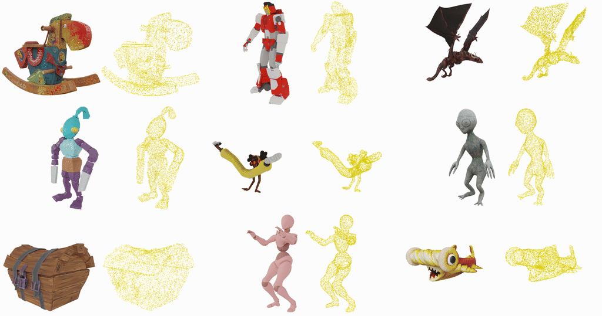

<div align="center">

<h1>🎬 ActionBench: Paired Video-3D Synthetic Benchmark</h1>

<a href='https://huggingface.co/datasets/facebook/actionbench'></a>




</div>

## 📖 Overview

ActionBench is a benchmark dataset of **128 paired video ↔ animated point-cloud samples** for evaluating animated 3D mesh generation from video.
The dataset consists of synthetic scenes of animated objects from [ObjaverseXL](https://objaverse.allenai.org/), rendered using **Blender 3.5.1**.

Each sample contains:
- **Video**: 16 RGBA frames with alpha mask
- **Camera** (`camera.json`): Camera parameters using Blender convention (`X_cam = X @ R^T + T`, camera looks along -Z). See [`projection.py`](https://huggingface.co/datasets/facebook/actionbench/blob/main/projection.py) for how to project the point cloud onto the image plane.
- **Animated Point Cloud**: Surface points sampled on the animated object with shape `(T, V, 6)` where:
  - `T=16`: number of keyframes
  - `V=100_000`: number of vertices (points randomly sampled on the mesh surface)
  - `6`: position `(x, y, z)` + normal `(nx, ny, nz)` for each point

  > **Note:** The point cloud is **tracked**: each point index corresponds to the same surface point deformed across timesteps, providing dense correspondences over time.

  The animation lie in normalized space `[-1., 1.]^3`.

## 📊 Evaluation

To evaluate on ActionBench, produce a list of animated meshes saved as `.glb` files.

Each subdirectory must be named with the corresponding `uid` from ActionBench:

```
predictions/
├── <uid_1>/
│   ├── mesh_00.glb
│   ├── mesh_01.glb
│   └── ...
├── <uid_2>/
│   ├── mesh_00.glb
│   └── ...
└── ...
```

Download the [ActionBench](https://huggingface.co/datasets/facebook/actionbench) dataset, then run the evaluation script:

```bash
python actionbench/evaluate.py \
    --pred_root predictions/ \
    --gt_root data/actionbench/data/ \
    --output_csv results.csv \
    --device cuda
```

> **Note:** Evaluation requires the same dependencies as [ActionMesh](../README.md) plus [PyTorch3D](https://github.com/facebookresearch/pytorch3d/blob/main/INSTALL.md).

Metrics are described in the [ActionMesh paper](https://arxiv.org/abs/2601.16148):
- **CD-3D**: Chamfer Distance 3D — measures geometric accuracy per frame
- **CD-4D**: Chamfer Distance 4D — measures spatio-temporal consistency
- **CD-M**: Motion Chamfer Distance — measures motion fidelity

## 🏆 Leaderboard

Average result over all 128 animated objects (ActionMesh seed=42).

| Method | CD-3D ↓ | CD-4D ↓ | CD-M ↓ |
|--------|---------|---------|--------|
| [TRELLIS](https://arxiv.org/abs/2412.01506) | 0.065 | 0.181 | . |
| [TripoSG](https://arxiv.org/abs/2502.06608) | 0.056 | 0.184 | . |
| [DreamMesh4D](https://arxiv.org/abs/2410.06756) | 0.104 | 0.152 | 0.265 |
| [LIM](https://arxiv.org/abs/2503.22537) | 0.089 | 0.126 | 0.243 |
| [V2M4](https://arxiv.org/abs/2503.09631) | 0.068 | 0.340 | 0.616 |
| [ShapeGen4D](https://arxiv.org/abs/2510.06208) | 0.056 | 0.170 | 0.348 |
| ActionMesh `--fast` | 0.054 | 0.089 | 0.156 |
| ActionMesh | **0.054** | **0.085** | **0.153** |

## 🏛️ License

See the LICENSE file for details about the license under which this dataset is made available.

## 📚 Citation

If you use ActionBench, please cite the following paper:

```
@inproceedings{Sabathier_2026_CVPR,
    author    = {Sabathier, Remy and Novotny, David and Mitra, Niloy J. and Monnier, Tom},
    title     = {ActionMesh: Animated 3D Mesh Generation with Temporal 3D Diffusion},
    booktitle = {Proceedings of the IEEE/CVF Conference on Computer Vision and Pattern Recognition (CVPR)},
    year      = {2026},
}
```
